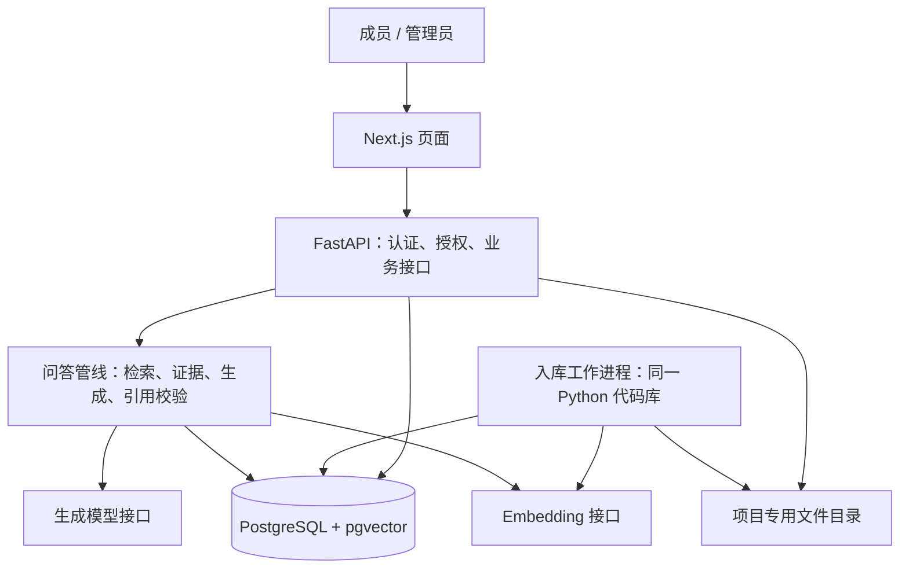

# 知据：项目实施方案

编制与资料核对：2026-10-20。状态：实施规划，应用代码尚未开发。

范围依据为 [原项目规划](../RAG项目规划_20261020/RAG项目规划.md)。本文确定本轮建议采用的架构和开发顺序；[任务清单](implementation-backlog.md) 提供逐项拆解。规划门槛均是目标，未取得效果或性能实测结果。

## 1. 实施结论

沿用 Next.js + TypeScript、FastAPI + Pydantic、PostgreSQL + pgvector，采用模块化单体。先做“5 份合成文档 → 入库 → 提问 → 原文引用”的垂直切片，然后补齐版本管理和登录权限，再用固定数据集决定混合检索与重排是否值得加入。

项目的主要展示价值落在四件事：引用能核对、更新不混用旧内容、权限从服务端生效、优化有对照证据。开发优先级按这四项安排。

本轮落地的是方案、任务分解与 Git 基线；数据库、服务、模型连接与质量指标均未验证。Git 已由用户在本轮明确要求初始化：`main`，初始提交 `28eae4b`。后续功能使用短分支，每个可回退且通过相关验收的阶段形成提交。

## 2. 开源社区参考及取舍

以下区分“上游已核对事实”和“本项目设计判断”。参考的是官方仓库、代码和文档；未在本机部署或压测这些项目。链接中的 main/stable 会变化，实现相关模块时再锁定版本或提交。

| 参考 | 核对到的实现或能力 | 本项目采用的思路 | 本期范围 |
|---|---|---|---|
| Dify | 文档列出向量、全文、混合检索及独立检索测试；检索源码在组装上下文和来源时再次授权片段 | 检索配置与生成配置分开；允许只测检索；来源输出前再校验权限 | 做少量明确的模式和运行记录，暂不建设可视化工作流平台 |
| RAGFlow | 文档分块预览、引用溯源、可配置生成/Embedding、多路检索 | 管理员先检查解析质量，成员能从引用看到原文 | 先支持文本型 PDF、MD、TXT；复杂版面和 OCR 后置 |
| Haystack | 组件式管线；DocumentJoiner 支持 RRF、去重与截取结果 | 解析、检索、融合、生成各有接口和可观察输出 | 首期直接实现小模块；框架是否引入由实际重复代码量决定 |
| pgvector | 默认精确近邻；ANN 以召回换速度，ANN 与过滤组合会影响候选数量 | 小语料直接做授权集合内的精确向量排序 | 先不建 HNSW/IVFFlat；以后根据规模与检索延迟决定 |
| Ragas | Faithfulness 衡量回答的陈述是否能由检索上下文支持 | 分开衡量召回与生成，人工记录引用是否支持结论 | 主指标先用自有评测器；LLM 评分作为辅助、单独计费 |

对应依据：[Dify 检索设置](https://docs.dify.ai/en/cloud/use-dify/knowledge/create-knowledge/setting-indexing-methods)、[Dify 检索测试](https://docs.dify.ai/en/cloud/use-dify/knowledge/test-retrieval)、[Dify 来源组装与授权代码](https://github.com/langgenius/dify/blob/main/api/core/rag/retrieval/dataset_retrieval.py)；[RAGFlow 官方仓库](https://github.com/infiniflow/ragflow)；[Haystack Joiners](https://docs.haystack.deepset.ai/reference/joiners-api)；[pgvector](https://github.com/pgvector/pgvector#filtering)；[Ragas Faithfulness](https://docs.ragas.io/en/stable/concepts/metrics/available_metrics/faithfulness/)。

这是结合本项目规模做出的架构判断，不能由这些项目的功能列表推导出本项目已经达到同样质量。本次仅参考设计，没有复制其实现；Dify 仓库说明其许可证基于 Apache 2.0 并附加条件，今后若复用代码，先核对对应版本的 [许可证](https://github.com/langgenius/dify/blob/main/LICENSE)。

## 3. 组件和代码边界



| 部分 | 负责的内容 | 建议模块 |
|---|---|---|
| Next.js | 四类业务页面、加载/失败状态、证据抽屉；不重复实现检索业务 | `apps/web` |
| FastAPI | 身份、知识库访问控制、上传、版本发布、查询和反馈 | `api/routes`、`auth`、`services` |
| 入库 | 校验、哈希、解析、分块、向量化、构建完整性检查 | `ingestion`、`parsers`、`chunking` |
| RAG | 向量与关键词检索、融合、上下文预算、结构化回答、引用校验 | `retrieval`、`rag` |
| 基础适配 | 数据访问、文件存储、模型客户端、超时和用量采集 | `db`、`storage`、`providers` |
| 评测 | 数据集校验、召回评分、人工评分导入、实验比较 | `evals` |

后端建议采用 SQLAlchemy + Alembic 管理关系模型与迁移；依赖版本在环境核对后锁定。上述路径是模块边界，不要求一次建立所有空目录。

API 与入库工作进程共用一个 Python 包和部署镜像，按不同命令运行；这属于同一应用的两个进程。入库任务存入 PostgreSQL，工作进程用短事务认领任务、租约和心跳发现中断，外部模型调用放在事务外。任务按至少一次执行设计，靠唯一约束和持久化进度保证可重入，不声称“恰好执行一次”。

认领可使用 `FOR UPDATE SKIP LOCKED`；官方文档明确提到它适用于多个消费者访问队列表的情形。具体实现仍需测试租约过期、重复认领与进程中断。[PostgreSQL SELECT](https://www.postgresql.org/docs/current/sql-select.html)

首期使用一个项目专用文件卷，数据库保存不可猜测的存储键；文件不放前端公开目录。暂不加入 Redis、Celery、对象存储服务、独立搜索集群或编排平台。数据库容器只供本项目使用；实际安装或启动属于后续实施，本轮未执行。

## 4. 数据模型与不可破坏的规则

| 实体 | 关键内容 |
|---|---|
| `users / sessions / memberships` | 登录用户、服务端会话、知识库成员及 reader/admin 角色 |
| `knowledge_bases` | 知识库信息与检索配置 |
| `documents` | 逻辑文档、停用标志、当前 `active_version_id` 和 `active_index_build_id` |
| `document_versions` | 不可变原始内容/解析产物引用、内容哈希、版本号、生效时间 |
| `index_builds` | 所属文档版本、解析/分块指纹、Embedding 配置、完整性状态 |
| `chunks` | 所属构建与版本、正文、定位、内容哈希、向量 |
| `ingestion_jobs` | 目标构建、当前步骤、租约、重试次数、错误分类、已确认进度 |
| `query_runs / query_run_evidence` | 查询所属用户/知识库、配置快照、证据映射、耗时、用量、状态 |
| `feedback / audit_events` | 反馈与发布、停用、成员权限变更的最小审计记录 |

核心约束：

1. **内容版本与索引构建分开。** 修改分块或 Embedding 配置会产生新的构建，不覆写原内容，也不让历史引用指向新文本。引用标识包含 `version_id + index_build_id + chunk_id + locator`。
2. **发布指针一次切换。** 校验构建完整、文档归属、向量维度和可生效时间后，在短事务内锁定逻辑文档，原子更新两个指针。约束保证构建属于该版本；并发发布检查预期旧指针，过时任务不能覆盖较新发布。
3. **查询走同一有效集合。** `AllowedActiveChunks(user, kb, now)` 由当前成员权限、文档未停用、当前发布指针和已生效时间共同决定；向量、关键词、融合、原文接口复用这个范围。不能先全库取 top-k 再靠前端剔除。
4. **失败构建不发布。** 旧版本继续服务；重试复用本地已确认成功的步骤。去重键限定知识库/逻辑文档/内容与处理指纹，不通过跨知识库去重响应暴露资料是否存在。
5. **Embedding 配置匹配。** P0 锁定一个经过验证的配置和向量维度。查询向量必须匹配索引配置；更换模型或维度需要显式迁移与重建，禁止把不同空间的向量直接比较。

首期不实现定时发布调度。管理员提交未来生效的版本可以保留待发布，到时显式发布；未来版本不能提前替换当前指针。正文版本不可变，发布指针、停用状态和审计信息可以变化。

## 5. 入库流程

```text
上传校验与内容哈希
  → 解析预览（标题/段落/页码）
  → 确认构建
  → 分块与定位
  → 分批 Embedding、保存已确认进度
  → 完整性校验
  → ready
  → 管理员发布（或本地切片显式自动发布配置）
```

版本的状态采用 `draft → processing → ready`，失败为 `failed`；是否正在服务以文档发布指针为准。任务状态采用 `queued → running → succeeded / failed / canceled`，另存 `step、attempt、next_retry_at、lease_until`，不把“重试”混成一个永不结束的状态。

| 输入 | 解析与定位规则 |
|---|---|
| Markdown | 先按标题路径、再按段落；保存源行号和解析文本区间；原始 HTML 不直接执行 |
| TXT | 明确编码，保留段落序号和字符区间；乱码或空文本不能报成功 |
| 文本 PDF | pypdf 逐页提取；首期不跨页拼接 chunk；定位到页码和该页解析文本区间 |

PDF 页码与解析文本引用属于 P0；精确到原 PDF 字形坐标的高亮后置。pypdf 官方说明它不能从图像提取文字，复杂版面也存在语义恢复限制；空页、异常字符和抽样质量检查失败时返回可读原因。[pypdf 提取局限](https://pypdf.readthedocs.io/en/stable/user/extract-text.html)

分块先试原规划的约 300～600 中文字符范围与少量重叠，同时用所选 Embedding 的 tokenizer 检查 token 上限。标题前缀、分块参数、规范化策略、解析器版本均进入处理指纹；超长内容按规则拆分，不静默截断。

上传设置文件大小、PDF 页数/解析资源和请求超时限制，具体上限在小样本试验后写入配置。限制属于工程配置，不能把任意超限都误报成扫描 PDF。

重复请求不重新发起本地已有成功结果的 Embedding。若提供方在超时前实际计费但本地未收到结果，费用及重试可能性要明确记录；不能承诺失败重试绝不重复产生外部费用。

## 6. 问答与引用契约

```text
确认身份与知识库权限
  → 捕获有效发布与权限范围
  → 检索（P0 仅向量，P1 可混合/重排）
  → 去重、控制上下文预算
  → 编号证据 C1…Cn
  → 生成结构化回答
  → 校验引用和回答状态
  → 再查权限/停用/发布是否变化
  → 返回回答、引用及最小运行记录
```

P0 先返回完整结果，不向浏览器流式发送未经校验的回答。优先把证据链做稳；后续是否增加流式体验单独评估。

建议回答结构：

```json
{
  "run_id": "server-generated-id",
  "status": "answered",
  "segments": [{"text": "示例结论", "citation_ids": ["C1"]}],
  "evidence": [{"id": "C1", "version_id": "...", "chunk_id": "...", "locator": {}}]
}
```

模型只返回状态、文本和本次局部引用编号；服务器负责补全真实来源信息，实际响应还包含文档标题、构建标识与版本提示。客户端和模型提交的任意文档 ID 都不能成为授权依据。

| 状态 | 用户可见行为 |
|---|---|
| `answered` | 展示回答、逐段引用和可打开的原文证据 |
| `insufficient_evidence` | 说明缺少依据，可提示补充资料；不保留无依据结论或伪造引用 |
| `needs_clarification` | 提出能帮助检索的具体澄清问题 |
| `conflicting_evidence` | 列出冲突资料及适用范围，请求补充条件或管理员处理 |
| `knowledge_changed` | 本次生成期间版本/停用/权限发生变化，丢弃待返回正文并提示重新查询 |
| `error` | 明确服务故障或响应格式错误，区别于知识库没有答案 |

不存在的引用编号、格式错误、该引用未进入实际模型上下文等情况，应阻止该答案发布并记录引用/生成错误。不能只删除引用标记后仍向用户显示同一段无依据正文。程序校验来源真实性；语义上是否支持结论由固定样本和人工评审另行检查。

把资料放在明确的数据区，禁止文档指令获取工具、密钥或更高权限；模型无业务执行工具。开发集保留干扰指令与多文档冲突案例，不能把 mock 测试通过当成真实模型已抵抗所有注入。

### 权限与历史回答

- 后端维护登录和服务端会话；前端通过受保护接口访问。成熟会话/密码实现、Cookie 与 CSRF 配套配置在认证模块落地时验证，不自行设计密码算法。
- 未登录返回 401；已登录但无对象访问权统一返回 404，避免对外区分不存在与不可见。运行记录与原文下载同样校验，禁止公开静态文件 URL 绕过。
- 新查询只用当前有效版本。旧版本的历史引用在仍有权限且文档未停用时可查，并明显标注“历史版本，已不适用于新查询”；停用整份文档后原文访问关闭。
- 撤销知识库权限后，新查询、原文、历史运行详情和导出均不可访问。历史记录可按保留策略保存在服务器；系统无法撤回用户已读或已自行保存的内容。
- 不做跨用户回答缓存。返回前发现范围变化时返回 `knowledge_changed`；这不表示能撤回此前已发送给模型供应商的上下文。首期仅使用合成资料。

## 7. 首批接口和页面

以下为接口草案，落地时由 Pydantic/OpenAPI 固化；ID 关系必须服务端验证。

| 接口 | 用途与权限 |
|---|---|
| `POST /auth/login`、`POST /auth/logout`、`GET /auth/me` | 登录、退出、会话检查 |
| `GET /knowledge-bases` | 仅列出本人可访问集合 |
| `POST /knowledge-bases/{kb_id}/documents` | 管理员上传，返回文档/版本/解析任务 ID |
| `POST /documents/{document_id}/versions` | 管理员上传新内容版本 |
| `GET /ingestion-jobs/{job_id}`、`POST .../{job_id}/retry` | 查询状态；管理员重试失败任务 |
| `POST /versions/{version_id}/builds`、`POST .../{version_id}/publish` | 确认预览后构建；完整就绪后发布 |
| `PATCH /documents/{document_id}` | 管理员停用或恢复文档；恢复前校验有效构建 |
| `GET /versions/{version_id}`、`GET /chunks/{chunk_id}` | 授权版本预览与真实原文片段 |
| `POST /knowledge-bases/{kb_id}/queries` | 提问，返回结构化回答与引用 |
| `GET /query-runs/{run_id}`、`POST .../{run_id}/feedback` | 本人可见的运行记录和反馈 |

需要下载时使用单独授权接口，不暴露磁盘路径。四类页面仍为问答、知识库、文档详情、运行与评测；先做问答和最小原文视图，再扩管理页。登录属于配套页面，不建设复杂用户管理后台。

## 8. 模型与中文检索选型

| 项目 | 计划 |
|---|---|
| 生成 | 适配独立 Chat 接口；先支持一个经过验证的提供方，记录模型名/配置/提示词版本 |
| Embedding | 独立 Embedding 客户端，验证中文语义、维度、token 限制、查询/文档编码约定及模型版本 |
| 关键词 | P1 小语料可先用 jieba 搜索分词 + 业务词典 + rank_bm25，在每次授权有效集合内计算；不跨用户共用未过滤语料池 |
| 重排 | 只预留接口；B 的错误分析表明排序是主要瓶颈时，再评估中文模型或服务 |

BAAI/bge-m3 可作为 Embedding 对照候选：模型卡列出多语种、1024 维和 8192 序列长度；这仅是上游规格，提供方部署可能另有限制，且尚未验证本机资源或本项目效果。本轮不下载或启动它。[BGE-M3 模型卡](https://huggingface.co/BAAI/bge-m3)

jieba 官方仓库列出搜索模式、自定义词典与 MIT 许可证；rank_bm25 仓库列出 BM25 实现与 Apache-2.0，并说明大规模生产有性能更强的替代。二者在本项目作为小规模、可替换的实验基线候选。本次核实了功能和仓库许可证标识，尚未核对目标 Python 环境中的发布包依赖、维护响应与安全状态；P1 接入前完成兼容性与维护核查并锁定版本，不宣称它们正在高频维护。[jieba](https://github.com/fxsjy/jieba)、[rank_bm25](https://github.com/dorianbrown/rank_bm25)

首期不把生成 API 的可用性当成 Embedding 可用性的证明。Model Desk 的执行模型配置属于开发协作配置，不自动成为本项目的产品模型配置，也不搬用其他项目的密钥。

2026-10-24 确认：生成模型为用户本地自部署的 OpenAI 兼容端点（qwen3.8，无密钥，最小连通与 JSON 引用契约实测通过，费用记“自有硬件，无 API 账单”）；该端点本身不提供 Embedding（实测 404），Embedding 已选定硅基流动 `BAAI/bge-m3` 免费标准版并完成最小连通与中文语义抽查（1024 维实测一致），真实向量写入的模型侧阻塞解除。连接信息与密钥只存 `.env`，不入库。

真实连接前要记录生成和 Embedding 各自的来源、请求条数、输入规模、费用上限与已有授权。最小连通可建议每类 1 个最小请求，中文检索验证另列小批次；是否按该规模调用要看所选提供方和费用边界。没有可核实用量/价格时费用记“未知”，不写 0。

## 9. 评测与优化顺序

阶段 1 的 10 个样例是冒烟检查，与最终 80 条评测集分开。5 份初始演示资料可为：A 库交付规则 v1、v2，A 库验收 FAQ，A 库整改/人工处理手册，B 库同名交付规则；用交叉引用和附录覆盖跨文档、无答案及干扰指令。另补极小 TXT/PDF 解析夹具，不把格式夹具计作业务文档数量。

80 条主集沿用原规划的 30/20/10/10/10 分类，开发集与留出集各 40 条；按问题族和近似问法分组切分，保持类别平衡。标准证据由人工确认。权限/生命周期至少 20 项独立断言，在阶段 2 出口全部通过。

**标准证据锚定内容，而非只存 chunk_id。** 每条 gold evidence 保存不可变 `version_id + 原文位置/文本区间 + 必需信息点`；对当前构建映射可接受的 chunks。改变分块时，必须复核该映射，不能因为 chunk ID 变化就把 Recall 下降误判成检索退化。跨段问题的每个必需证据单元都要计入分母。

| 实验 | 固定条件与变量 | 决策 |
|---|---|---|
| A | 授权有效集合内精确向量检索；最终 evidence top-5 | 保存第一版可复跑基线 |
| B | 与 A 保持语料、生成模型、分块、提示词、最终 top-5 相同；候选分别取约 20 后 RRF 去重融合 | 检查关键词是否补回编号、术语、期限等精确条件；RRF 常数等只在开发集调 |
| C（可选） | 固定 B 的候选集与生成条件，仅增加重排再取 top-5 | 记录质量收益、延迟和费用；收益不足则不保留 |

候选 20 和最终 5 都是起步实验配置，不是通用最优值。A/B 的检索模式整体是一个实验因素；若再改分块、候选规模或模型，应另开实验记录，避免归因混乱。留出测试只对开发集选定的方案集中验证，不能反复根据其题目调参。

主指标保留原规划定义和建议门槛：Evidence Recall@5 ≥85%、可回答问题通过率 ≥75%、引用支持率 ≥90%、无答案处理正确率 ≥90%。报告实际分子/分母、误拒可回答问题数、引用缺失数、每类错误。小样本目标不外推为企业准确率。

2026-10-24 增补（采纳第三方评审 `docs/review-gaps-20261021.md`，任务落点见任务清单修订记录）：评测集本身要有有效性验收。语料在 M1 检索基线之前扩充到 150～250 个有效条款、语义近邻干扰 ≥30%（kb-c 外包规则、v3 草案与 v2.1 废止版、数字写错的培训讲义、同规则多措辞改写）；纯向量基线 Evidence Recall@5 落在 60～85% 视为有效，高于 90% 判定干扰不足、继续加干扰——基线太高的评测集测不出组件差异。计算/工作日题按推理题单列“计算类正确率”（必须输出工作日序列，只给最终日期不算通过），澄清、无答案、干扰指令同样单列口径；每条评测失败固定按六类归因（R1/R2/P/G1/G2/G3）输出分布，金标核对记录如实写核对人 `author`。解析夹具使用已就位的 `examples/format-fixtures/`（跨页表格 PDF、无文本层 PDF、脏格式 TXT，2026-10-24 经实测复核），解析器 fail-loud：无法解析的页显式失败并记录，不静默跳过；格式夹具不计入业务文档数量。

成本和延迟记录样本数、模型/代码/语料/配置版本、并发数、冷暖状态、P50/P95、分阶段耗时和用量。检索与生成分开评测；规则、权限、版本和引用校验测试默认用 mock，真实模型回归单独执行。

评测输入中只有 `allowed_kb_ids` 并不足以测试鉴权，还需使用实际身份/会话进入同一业务服务。原始运行输出保存在忽略的 `evals/runs/`；Git 中的 `evals/results/` 只收录合成公开资料对应的、经过检查的报告和必要原始结果，私有查询与正文不入库。

## 10. 里程碑与阶段验收

| 阶段 | 主要成果 | 退出条件 |
|---|---|---|
| M0 决策与准备 | 最小 PRD、环境核对、5 份语料、模型配置方案、评测口径 | 文档和接口边界清楚；真实模型未确认则明确阻塞真实链路，仅允许离线骨架工作 |
| M1 可追溯闭环 | 解析分块、精确向量、结构化回答、原文视图、运行记录 | 10 个样例可复跑；可回答项可追到原文；无答案无伪造引用；失败可见；真实接入另有实测证据 |
| M2 版本与权限 | 后台任务、重试、原子发布、停用、登录、全链路授权 | 新旧不混用，任务中断不污染当前构建；至少 20 项权限/生命周期断言全部通过 |
| M3 优化证据 | 80 条冻结集、A/B 对照、按需 C、至少 3 类失败案例 | 能复跑、能解释收益与代价；达到或如实说明与目标的差距；不要求增加组件后必须获胜 |
| M4 用户验证 | 5～10 人完成指定查阅任务、反馈和一次迭代 | 记录实际任务完成情况、引用理解、耗时和失败点；参与者招募另行协调；上线后监控与 badcase 回流完成设计（S4-T05，仅设计不实现） |
| M5 作品交付 | 安装说明、2～3 分钟演示、评测和案例复盘 | 干净环境可复现；仅把已实现与实测结果写进成果；公开部署另行决定 |

前一阶段对应能力未验收，不将依赖它的后续能力标为完成。可以提前开展独立的离线准备，例如模型未确认时编写解析测试；这些工作不能替代 M0 真实连接或 M1 真实问答的验收。

任务清单里的文档路径是交付内容建议，可合并到本方案、PRD、评测说明和阶段记录中，不需要为每个任务建立一份重复文档。阶段 5 的本地展示材料可在 M3 后先整理，邀请试用不阻塞所有作品整理工作；完整项目验收仍分别报告用户验证是否完成。

## 11. 第一批实际开发顺序

1. **环境核对**：只检查本项目需要的 Python、Node、包管理器、Docker/Compose、端口与 Git；不扫描其他项目的模型配置，不触碰密钥。
2. **固定输入与契约**：编写上述 5 份合成文档、10 条冒烟样例、原文定位和响应 schema；业务规则沿用团队交付场景，无须再次确认已明确的范围。
3. **项目骨架与数据库迁移**：先建立 API、PostgreSQL 配置和必要前端入口；落实版本/构建分离、发布指针、任务唯一约束。
4. **纯本地入库**：先 MD/TXT，随后文本 PDF；完成哈希、解析预览、分块定位和失败状态，默认不调用真实模型。
5. **模型适配与 mock 链路**：独立 Chat/Embedding 接口及确定性的测试替身；以此验证错误处理和引用契约，结果显式标注 mock。
6. **确认来源和调用边界后做真实最小链路**：验证两类模型、维度与中文样例，再完成向量查询、结构化生成和可核对引用。
7. **接入最小问答页面并留基线**：做引用抽屉、无答案/失败状态和运行记录，跑 10 条样例；M1 验收后进入 M2 管理与权限。

真正待补充的信息集中在产品生成模型与 Embedding 的可用来源/费用边界，以及后续环境核对发现的实际限制。数据库默认新建本项目专用实例、业务场景沿用原规划、权限响应与历史引用按本文方案推进；这些常规取舍不再逐条交给用户选择。

## 12. 当前完成状态

| 状态 | 内容 |
|---|---|
| 已完成 | 阅读两份原规划；本地 Git 初始化和忽略规则验证；官方开源资料核查；本实施方案及可追踪任务清单 |
| 未验证 | Python/Node/Docker/PostgreSQL 的本项目兼容性；产品模型来源与费用；真实解析/检索/生成效果；部署与性能 |
| 未实现 | 应用代码、数据库迁移、演示语料与评测数据集、业务页面、所有运行能力 |

本轮未安装应用依赖、启动本项目数据库、下载模型或调用产品 Chat/Embedding 服务。此前 Qwen/Pi 调用用于整理开发任务清单，不能作为本项目真实模型连通或 RAG 效果证据。

2026-10-24 增补（ZCode/GLM 会话，明细见 `docs/worklog-20261024-zcode.md`）：项目 Python 环境已建立——uv 0.13.0 + uv 托管 CPython 3.12.15，`.venv` 与 `uv.lock` 已锁定，当前依赖仅 pypdf 6.21.2、pytest 9.1.1；服务依赖（FastAPI/SQLAlchemy 等）在 M1 骨架任务中补充锁定。第三方评审结论已合并进任务清单，`examples/public-docs/` 同步改名 `synthetic-docs/`；冒烟题锚点与格式夹具声明完成机器校验（`evals/anchor-check-20261024.md`、`evals/fixture-check-20261024.md`），冒烟题作者人工复核仍待完成。仍未验证：产品模型连通、PostgreSQL+pgvector 可用性、任何实现与效果指标。本轮未安装数据库、未启动服务、未调用任何模型。
